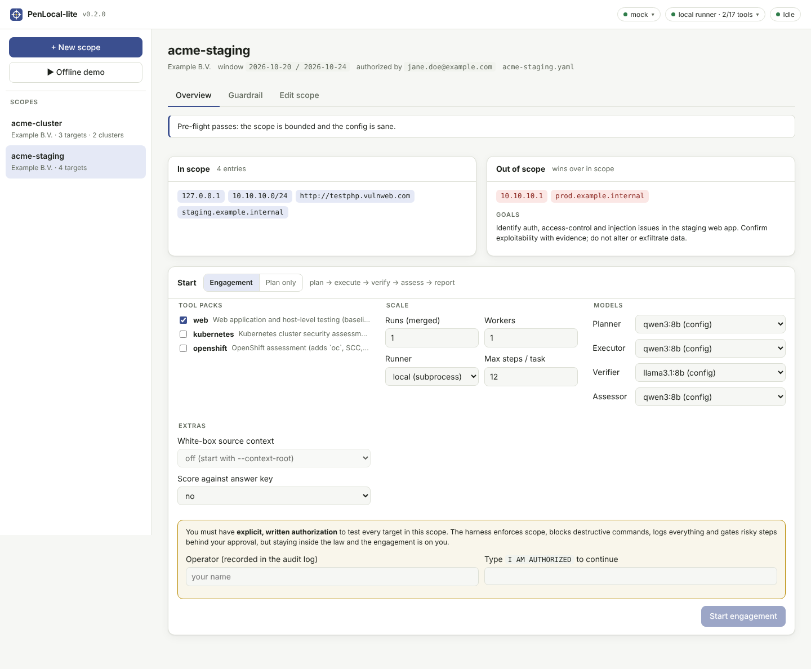
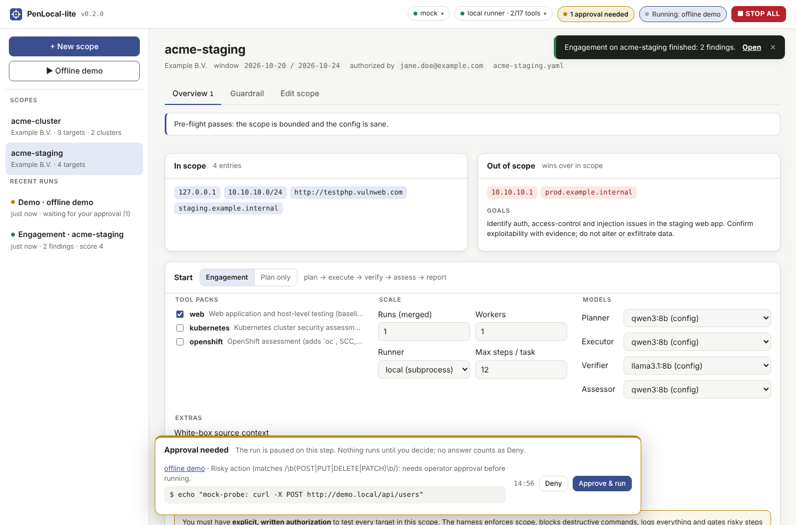
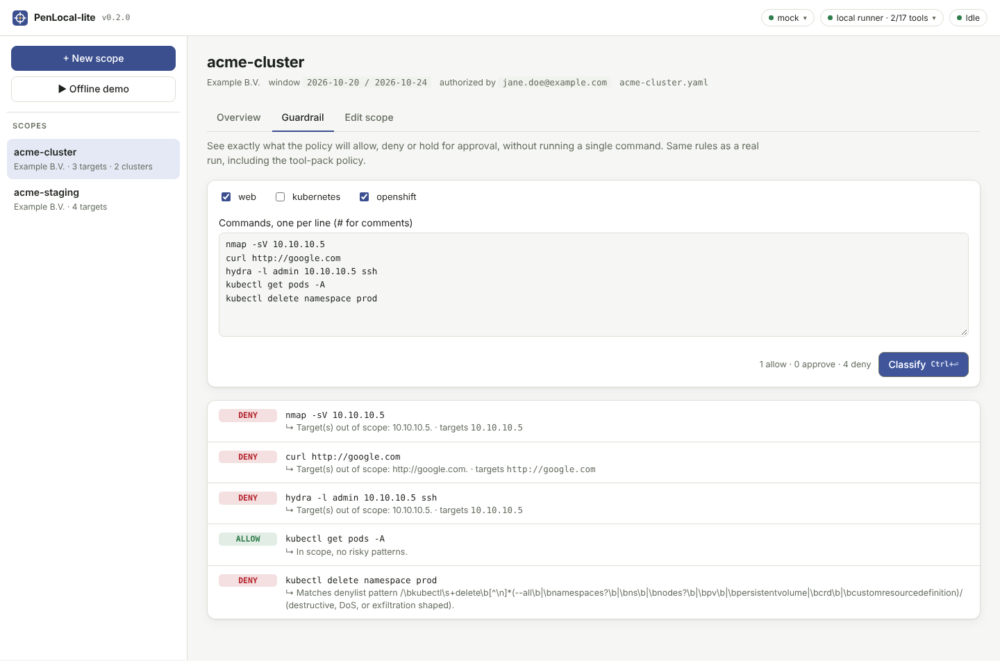
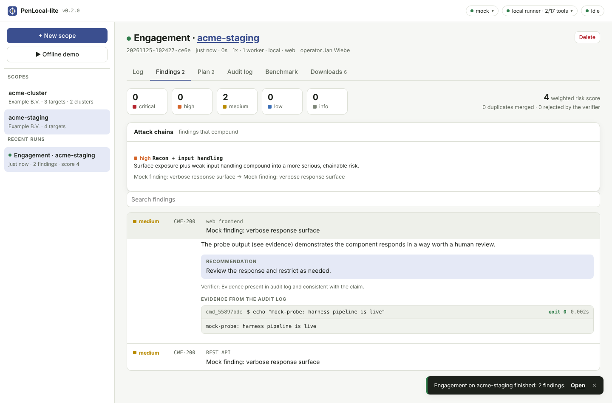

# PenLocal-lite

A local-AI penetration-testing **harness** in Python, inspired by Warpnet's
[PenLocal](https://warpnet.nl/blog/een-jaar-ai-pentesting-op-eigen-hardware/).

The guiding idea from that write-up: **an LLM is only the brain.** On its own it
just reads and writes text — it can't run commands, forgets earlier evidence,
and can't check its own answers. All the real work is in the *harness* around
the model that decides what it sees, what it may run, and what happens to its
output. This project is that harness, built to drive a model you host yourself
with [Ollama](https://ollama.com) (qwen3, llama3.1, …) so no engagement data
leaves your machine.

> ⚠️ **Authorized use only.** Point this at systems you have explicit written
> permission to test. The harness enforces scope, blocks destructive commands,
> logs everything, and gates risky steps behind your approval — but the legal
> and ethical responsibility is yours. See [SECURITY.md](SECURITY.md) for the
> rules of engagement.

**Contents:** [Quickstart](#try-it-in-10-seconds-no-gpu-no-model-server-nothing-touched)
· [Architecture](#the-five-harness-components-mirroring-the-blog)
· [Why repetition](#why-repetition-matters)
· [Tool packs (k8s/OpenShift)](#tool-packs--kubernetes--openshift)
· [Backends](#backends--the-brain-is-swappable)
· [Install & use](#install-real-models)
· [Web UI](#web-ui)
· [Releases](#releases)
· [Safety model](#safety-model-concretely)
· [Layout](#layout)

## Audit the guardrail before you run anything

Before an engagement, see exactly what the policy will allow, deny, or gate —
without running a single command:

```bash
python -m penlocal explain --scope scope.yaml \
  --cmd "nmap -sV 10.10.10.5" \
  --cmd "curl http://google.com" \
  --cmd "hydra -l admin 10.10.10.5 ssh"
#  [ALLOW  ] nmap -sV 10.10.10.5            ↳ In scope, no risky patterns.
#  [DENY   ] curl http://google.com         ↳ Target(s) out of scope.
#  [APPROVE] hydra -l admin 10.10.10.5 ssh  ↳ Risky action: needs operator approval.
```

`penlocal run` also pre-flights your config and scope, and **refuses** to start
on an empty or unbounded (`0.0.0.0/0`) scope.

---

## The five harness components (mirroring the blog)

| Blog component | Module | What it does |
|---|---|---|
| **Planner** | `planner.py` | Turns the scope (+ optional source code) into a threat model and a flat list of *component × attack-class* tasks, so coverage is explicit. |
| **Sandbox** | `sandbox.py` + `scope.py` | The only path from model to anything real. Enforces scope, hard-blocks a denylist (destructive / DoS / exfil / reverse-shell), gates risky steps behind human approval, runs with a timeout, has an emergency stop. `local` or fresh-`docker`-per-task runners. |
| **Auditlog** | `auditlog.py` | Append-only JSONL of every command with full output. Findings cite entry ids, so every claim traces back to what actually happened. |
| **Verifier** | `verifier.py` | A *different* model re-judges each finding against the raw audit evidence. Invented findings with no real output behind them fail here. |
| **Assessor** ("Beoordelaar") | `assessor.py` | Dedupes, normalises severity, hunts for attack **chains**, and computes a weighted risk score (critical ≈ 5× trivial, as in the blog). |

The per-task agent loop that sits between Planner and Verifier is `executor.py`.
`harness.py` wires it all together. **Model and harness are separate** — each
role is just a model handle (Ollama, an OpenAI-compatible server, or the mock)
pointed at whatever model you choose. See [Backends](#backends--the-brain-is-swappable).

```
 plan ─▶ for each task: execute (sandbox+audit) ─▶ verify ─▶ assess ─▶ report
   ▲                         │ risky step?                      │
 Planner                operator approval                  dedupe/chains/score
```

---

## Why repetition matters

The blog's sharpest practical point: an LLM is non-deterministic, and runs
disagree *a lot* — one run found 16% of an app's vulns, another 95%. One run
counts the rest as missed. Because a local run is cheap, you repeat and merge.
Here that's `runs: 3` (config) or `--runs 3` (CLI): the whole task set runs N
times, candidate findings are pooled, *then* verified and assessed together.

---

## Try it in 10 seconds (no GPU, no model server, nothing touched)

```bash
pip install -r requirements.txt
python -m penlocal demo --key answer_key.example.yaml
```

The `demo` runs the **entire** pipeline — plan → execute → verify → assess →
report → benchmark — using the deterministic `mock` backend and harmless `echo`
probes. It proves the wiring and writes `report.md/json/html`. The mock brain is
intentionally dumb, so it recovers almost none of the answer key: that's the
scorer being honest, not rigged.

## Tool packs — Kubernetes & OpenShift

Tool packs teach the harness about a target type in two places at once: the
**planner** learns the right attack classes and (read-only-first) tools, and the
**policy** gets stricter for that type. Select with `--toolpack` (repeatable) or
`toolpacks:` in the config. `openshift` implies `kubernetes`.

| Pack | Planner learns | Policy adds |
|---|---|---|
| `web` (default) | recon, authn, access control, injection, SSRF, misconfig, secrets, CVEs | built-in defaults |
| `kubernetes` | RBAC & privesc, exposed kubelet/etcd/API, privileged pods & host mounts, secrets, NetworkPolicy gaps, image CVEs; tools: `kubectl get/describe/auth can-i`, kube-bench, kube-hunter, kubeaudit, kubescape, trivy, popeye | see below |
| `openshift` | + SCCs, projects, routes, BuildConfigs/ImageStreams, `oc adm`; tools: `oc whoami/get/describe`, `oc adm policy who-can` | + `oc` verb policy |

How the cluster policy classifies commands:

- **ALLOW** (read-only) — `kubectl get/describe/logs/auth can-i`, `oc get/whoami`,
  and the scanners (kube-bench, kubeaudit, kubescape, trivy, popeye) in report mode.
- **APPROVE** (needs a human) — anything state-changing or intrusive:
  `kubectl create/apply/run/patch/scale/exec/port-forward/delete`, `--privileged`
  or host-namespace pod specs, `kube-hunter --active`, all `oc new-app/start-build/adm`.
- **DENY** (hard block) — destructive, cluster-wide, irreversible:
  `kubectl delete namespace|node|--all`, `drain`, `cordon`, `taint`,
  `oc delete project`, force-delete with `--grace-period=0`.

Plus a cluster-context guard: set `clusters:` in your scope, and a `kubectl`/`oc`
command selecting an out-of-scope `--context` is denied before it runs.

```bash
# audit exactly what a cluster run would allow/deny/gate, running nothing:
python -m penlocal explain --scope scope.k8s.example.yaml --toolpack openshift \
  --cmd "kubectl get pods -A" \
  --cmd "kubectl delete namespace prod" \
  --cmd "oc adm policy who-can use scc privileged"

# a real cluster run (kubectl/oc + scanners must be installed and authorized):
python -m penlocal run --scope scope.k8s.example.yaml --toolpack kubernetes --runs 3 --html
```

No exploits are bundled — packs describe standard, operator-installed assessment
tools and run them under the same scope/approval/audit gates.

## Backends — the brain is swappable

| Backend | Use it for | Set with |
|---|---|---|
| `ollama` (default) | local models via [Ollama](https://ollama.com) | `backend: ollama` |
| `openai-compat` | vLLM, `llama.cpp --server`, LM Studio, TGI | `backend: openai-compat`, `api_base` |
| `mock` | offline demos & tests | `--backend mock` |

All three satisfy the same tiny interface, so any role can point at any
backend/model — and all can be kept fully local.

## Install (real models)

```bash
cd penlocal-lite
python3 -m venv .venv && source .venv/bin/activate
pip install -r requirements.txt

# host your models locally
ollama serve &
ollama pull qwen3:8b
ollama pull llama3.1:8b        # a different family for the verifier
```

## Use

```bash
# 1. confirm your local models are reachable
python -m penlocal check --config config.example.yaml

# 2. write a scope file (start from the example) — this is the guardrail
cp scope.example.yaml scope.yaml && $EDITOR scope.yaml

# 3. see the plan only (no commands run)
python -m penlocal plan --scope scope.yaml --context ./path/to/source

# 4. full run: plan → execute → verify → assess → report
python -m penlocal run --scope scope.yaml --context ./src --runs 3 --workers 4 --html

# 5. score a run against your pentesters' answer key (the blog's method)
python -m penlocal benchmark --scope scope.yaml --key answer_key.yaml
#    …or score a report you already produced:
python -m penlocal benchmark --report penlocal-run/reports/report.json --key answer_key.yaml
```

Outputs land in `./penlocal-run/reports/`: `report.md`, `report.json`,
`report.html`, plus the full `audit.jsonl`.

### Scale knobs

- `--runs N` — repeat the whole task set N times and merge candidates before
  verification. The blog's key finding: runs disagree hugely (one found 16% of
  an app's vulns, another 95%), so repetition is how a cheap local model reaches
  frontier-level recall. One local run counts the rest as missed.
- `--workers N` — run tasks within a run in parallel. Each task gets its **own**
  sandbox and runner; with `--runner docker` that's a fresh container per task,
  destroyed after — the blog's "new sandbox per task" model.

### Benchmark

`benchmark` reproduces the write-up's measurement: your pentesters write a
weighted answer key (`answer_key.example.yaml`) — a critical counts ~5× a
trivial issue — and the harness is scored on how much of that *weight* it
recovers, with per-severity breakdown and a false-positive count. That's how you
decide whether 3 merged runs of a local model match one run of a frontier model,
for a fraction of the cost and with no data leaving the box.

### White-box testing

Pass `--context <dir-or-file>` to feed source code to the planner. As the blog
notes, reading is the cheapest thing an LLM does, so testing *with* the source
is the default when it's available — it lets the planner aim each attack class
at the right component.

### The scope file is the contract

`scope.yaml` defines `in_scope` (CIDRs, hosts, URLs), `out_of_scope` (wins over
in-scope), and optional extra `denylist` / `risky` patterns appended to the
built-in defaults. Any command whose targets don't all resolve to in-scope
hosts is denied before it runs.

## Web UI

The same harness, in the browser: write and audit scopes, start engagements,
approve risky steps as they come, hit the emergency stop, and read findings with
the audit evidence behind them. Like `ansreview serve`, it is standard library
only and needs no CDN, so it runs on an air-gapped box.

```bash
python -m penlocal serve --config config.example.yaml --scopes ./scopes
#  penlocal web UI: http://localhost:8770/?token=…
python -m penlocal serve --backend mock --scopes ./scopes   # try it with no model server
```

Open the printed link once; the token becomes a cookie. The **Offline demo**
button runs the whole pipeline with the mock brain and harmless `echo` probes,
including one step that waits for your approval.

[](docs/screenshots/scope.png)

| | |
|---|---|
| [](docs/screenshots/approval.png) | [](docs/screenshots/guardrail.png) |
| [](docs/screenshots/findings.png) | |

What you get:

- **Scopes** — every `*.yaml` in `--scopes` with an `in_scope` list. Create and
  edit them in the UI (YAML, validated, regexes checked, conflict-safe saves);
  pre-flight errors and warnings show next to the file. Answer keys (files with a
  `vulnerabilities:` list) in the same folder become selectable for scoring.
- **Guardrail tab** — the `explain` command: paste commands, pick tool packs, see
  ALLOW / APPROVE / DENY with the reason, without running anything.
- **Start** — *Engagement* (plan → execute → verify → assess → report) or *Plan
  only*. Tool packs, runs, workers, runner, max steps, a model per role (from the
  models your backend has), white-box source context and an answer key. A run
  needs the same typed `I AM AUTHORIZED` as the CLI, and the operator name goes
  into the audit log. Pre-flight errors refuse the run.
- **Live** — phase, progress and the console log as it happens. A risky command
  **pauses the run** and shows up as an *Approval needed* card on every page
  (and in the tab title); nothing runs until someone clicks *Approve & run* or
  *Deny*. No answer within `--approval-timeout` (default 15 min) counts as Deny.
- **Emergency stop** — per run, or **STOP ALL** in the top bar. It sets the
  harness's shared stop event: no worker starts another command, pending
  approvals are declined, and the stop is written to the audit log.
- **Findings** — by severity, with chains, the weighted score, the verifier's
  notes and the **cited audit entries** (command, exit code, output) inline.
- **Plan**, **Audit log** (filter by kind, search output), **Benchmark**
  (weighted recall per severity against an answer key) and **Downloads**
  (report as Markdown/HTML/JSON, `audit.jsonl`, threat model, console log).

Runs execute one at a time (they share the GPU) in-process; up to 10 can wait.
Each run gets its own folder under `<workdir>/runs/<id>/` with a copy of the
scope it ran against, so history survives a restart of the server.

### What the browser can and cannot change

The UI is locked down the same way as `ansreview serve`:

- binds to `127.0.0.1`; every API call needs the access token
  (`--token` or `$PENLOCAL_WEB_TOKEN`, else random), POSTs need an
  `X-Penlocal` header and a same-origin `Origin` (no cross-site form posts),
  strict CSP, no third-party assets;
- the **backend and model endpoints** come only from the config file /
  environment, never from the browser; model names are validated;
- scope files are only read and written inside `--scopes`; source context only
  under `--context-root` folders;
- auto-approving risky steps is only offered when the server was started with
  `--allow-auto-approve` (lab use).

| Flag | Default | |
|---|---|---|
| `--scopes DIR` | `./scopes` | scope files and answer keys |
| `--workdir DIR` | `./penlocal-web` | runs, audit logs, reports |
| `--bind`, `--port` | `127.0.0.1`, `8770` | beyond loopback: put TLS in front |
| `--token` | random | or `$PENLOCAL_WEB_TOKEN` |
| `--no-auth` | off | loopback only |
| `--context-root DIR` | none | repeatable; folders runs may read as white-box context |
| `--approval-timeout S` | `900` | seconds before an unanswered approval is declined (0 = wait forever) |
| `--allow-auto-approve` | off | lab use only |
| `--open` | off | open the browser |

Plus the usual `--config`, `--backend`, `--runs`, `--workers`, `--runner` and
`--toolpack` defaults for the run form.

### Developing the UI

The React + TypeScript source lives in `web/` and is built into
`penlocal/web/static/`, which is committed so `pip install` needs no Node (the
`web` workflow checks the bundle matches the source):

```bash
cd web && npm ci
npm run dev          # Vite on :5173, proxying /api to `penlocal serve --port 8770`
npm test && npm run build
```

## Releases

Releases are automatic, the same way as in ansreview:

| When | What |
|---|---|
| One of your pull requests is merged into `main` | a release right away (bot PRs such as Renovate don't start one) |
| Every Monday at 05:23 UTC | a release of whatever was merged since the last one, e.g. dependency updates |

Nothing happens when `main` has no commits since the last tag. The bump comes from
the labels on the PRs merged since the last release: `release:major` → major,
`release:minor` → minor, otherwise patch. Label a PR `no-release` to keep its
merge from starting one (it goes out with the next release).

The `release` workflow then runs the tests, bumps `__version__` in
`penlocal/__init__.py` (the only place the version lives), commits
`release: vX.Y.Z` to `main` with an annotated tag, builds the wheel (with the web
UI) and sdist, and creates the GitHub release with install lines and notes
generated from the merged PRs. Install a release with:

```bash
pip install https://github.com/jwklijnsma/penlocal-lite/releases/download/vX.Y.Z/penlocal_lite-X.Y.Z-py3-none-any.whl
```

By hand: **Actions › release › Run workflow**, or with the GitHub CLI:

```bash
make release                    # patch
make release BUMP=minor         # or BUMP=major, or VERSION=1.0.0
make release-dry-run            # test and build everything, publish nothing
```

---

## Safety model, concretely

- **Scope gate** — targets extracted from each command; all must be in scope.
- **Denylist (hard)** — `rm -rf`, `mkfs`, `dd`, fork bombs, DoS tooling,
  pipe-to-shell, reverse shells, abusive scan rates… blocked, never run.
- **Risky → approval** — brute-forcers, exploit frameworks, `sqlmap --dump`,
  state-changing HTTP, intrusive NSE scripts… only run after you say yes.
  (`--auto-approve-risky` exists for lab use; prompting is the default.)
- **Audit** — every command + output on disk; findings must cite evidence ids.
- **Different verifier model** — catches the executor's hallucinations.
- **Emergency stop** — `Sandbox.stop()` halts the engagement immediately.
- **Isolation** — `local` runner enforces scope in-process but shares the host;
  for real separation use `--runner docker` (fresh container per task) and run
  the whole thing from a throwaway VM.

## What's deliberately left to a human

Same two phases the blog keeps off the machine: the pre-engagement scoping
conversation, and deciding which technically-valid finding actually *matters*
to this organisation. The harness surfaces and verifies; a pentester judges.

---

## Layout

```
penlocal/
  config.py     roles → backend/models, limits, runner, runs, workers
  llm.py        backends: LocalLLM(Ollama) · OpenAICompatLLM · MockLLM + factory
  scope.py      scope + denylist/risky policy   ← the guardrail
  auditlog.py   append-only JSONL evidence store
  planner.py    threat model + task breakdown
  executor.py   per-task agent loop (emits JSON, never executes)
  sandbox.py    scope-gated runner (local/docker) + approval + shared stop
  verifier.py   second-model evidence check
  assessor.py   dedupe + severity + chains + score
  benchmark.py  weighted answer-key scorer (recall, per-severity, FPs)
  report.py     Markdown / JSON / HTML output
  validation.py pre-flight checks (bad backend, empty/unbounded scope, …)
  toolpacks.py  domain packs: web / kubernetes / openshift (planner + policy)
  harness.py    orchestrator (plan→execute→verify→assess), parallel + stop
  cli.py        `python -m penlocal {check,plan,explain,run,demo,benchmark,serve}`
  web/          `penlocal serve`: stdlib HTTP server + the built UI (static/)
web/            React + TypeScript source of the UI
tests/test_smoke.py   22 offline tests: guardrails, audit, dedupe, scoring,
                      backends, validation, k8s/openshift policy, and a full
                      end-to-end mock pipeline
tests/test_web.py     9 offline tests for the web UI: auth/CSRF, scope files,
                      explain, authorization + pre-flight, full runs, approvals,
                      approval timeout, emergency stop, history after restart
```

Run the offline tests with `python -m pytest tests/` (31 tests, no model server).

Install as a command with `pip install -e .` (then just `penlocal ...`), or grab a
wheel from the [releases](https://github.com/jwklijnsma/penlocal-lite/releases). `make help` lists the dev shortcuts.

## Not included (on purpose)

No exploits, payloads, or weaponised tooling ship here. The executor runs
whatever standard tools *you* have installed (nmap, curl, sqlmap, …) under the
scope and approval gates. This is an orchestration/guardrail layer, not an
attack kit.

## License

MIT — do good, stay authorized.
