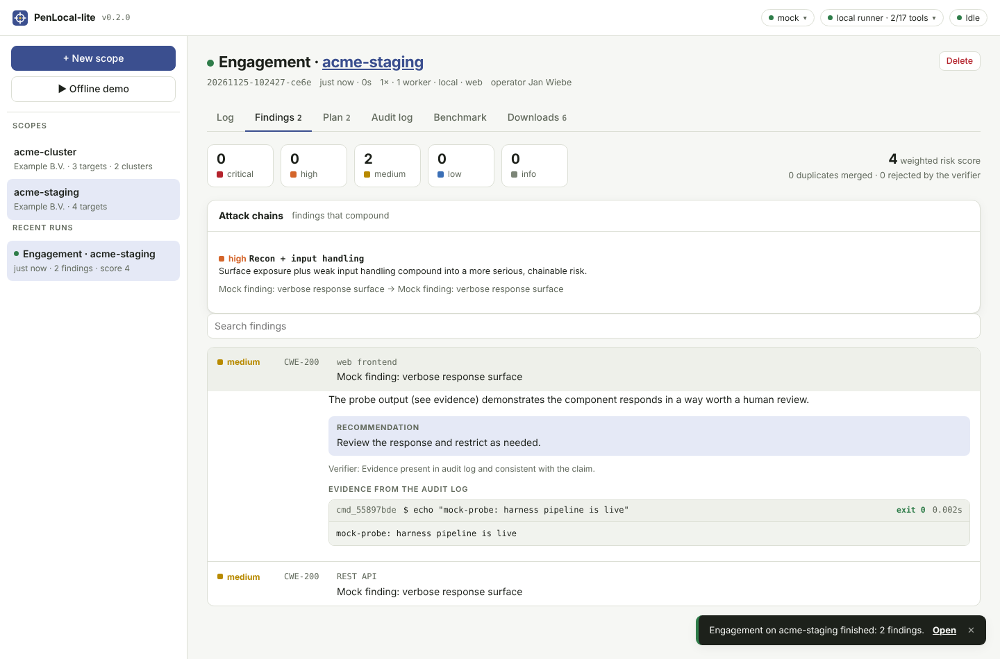

# PenLocal-lite

**A local-AI penetration-testing harness in Python**, inspired by Warpnet's
[PenLocal](https://warpnet.nl/blog/een-jaar-ai-pentesting-op-eigen-hardware/).
An LLM is only the brain: the harness decides what it sees, what it may run and what
happens to its output. It drives a model you host yourself with Ollama, so no engagement
data leaves your machine.



<div class="grid cards" markdown>

-   :material-shield-check: **[Audit the guardrail](guardrail.md)**

    Check what the sandbox blocks before you run anything.

-   :material-timer-sand: **[Try it in 10 seconds](try-it.md)**

    Mock model, no GPU, nothing touched.

-   :material-monitor-dashboard: **[Web UI](web-ui.md)**

    Scope, approvals and findings in the browser.

-   :simple-kubernetes: **[Kubernetes and OpenShift](tool-packs.md)**

    Tool packs for cluster assessments.

</div>

## The five harness components

| Component | Module | What it does |
|---|---|---|
| **Planner** | `planner.py` | Turns the scope into a threat model and explicit *component × attack-class* tasks |
| **Sandbox** | `sandbox.py` + `scope.py` | The only path to anything real: scope, denylist, approval for risky steps |
| **Auditlog** | `auditlog.py` | Append-only JSONL of every command and its full output |
| **Verifier** | `verifier.py` | A *different* model re-judges each finding against the raw evidence |
| **Assessor** | `assessor.py` | Dedupes, normalises severity, finds attack chains, scores risk |

```
 plan ─▶ for each task: execute (sandbox+audit) ─▶ verify ─▶ assess ─▶ report
```

!!! danger "Authorized use only"
    Point this only at systems you have explicit written permission to test. The harness
    enforces scope, blocks destructive commands, logs everything and asks before risky
    steps — but the legal and ethical responsibility is yours. See the
    [security policy](https://github.com/jwklijnsma/Penlocal-lite/blob/main/SECURITY.md).
