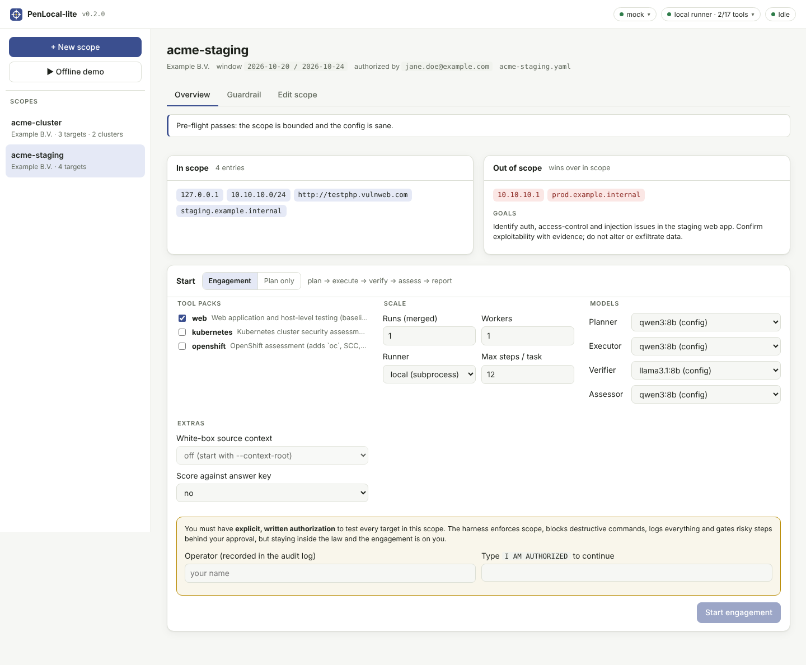
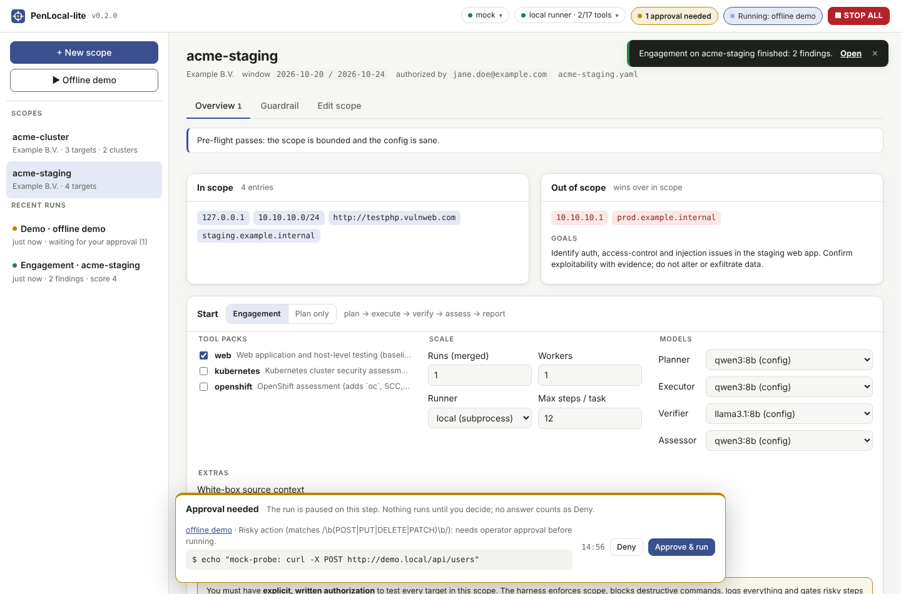
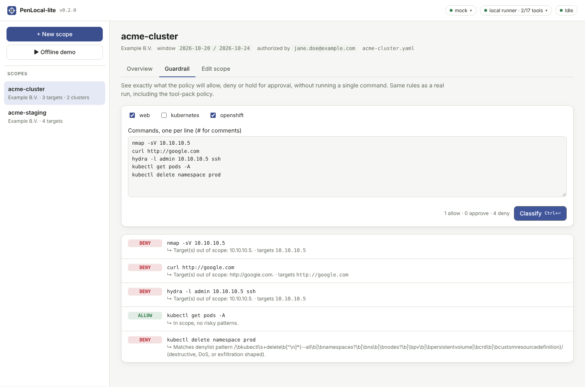
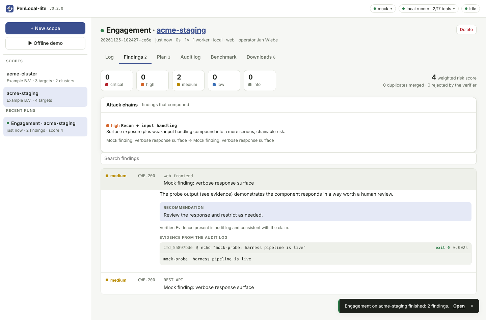

# Web UI

The same harness, in the browser: write and audit scopes, start engagements,
approve risky steps as they come, hit the emergency stop, and read findings with
the audit evidence behind them. Like `ansreview serve`, it is standard library
only and needs no CDN, so it runs on an air-gapped box.

```bash
python -m penlocal serve --config config.example.yaml --scopes ./scopes
#  penlocal web UI: http://localhost:8770/?token=…
python -m penlocal serve --backend mock --scopes ./scopes   # try it with no model server
```

Open the printed link once; the token becomes a cookie. The **Offline demo**
button runs the whole pipeline with the mock brain and harmless `echo` probes,
including one step that waits for your approval.

[](docs/screenshots/scope.png)

| | |
|---|---|
| [](docs/screenshots/approval.png) | [](docs/screenshots/guardrail.png) |
| [](docs/screenshots/findings.png) | |

What you get:

- **Scopes** — every `*.yaml` in `--scopes` with an `in_scope` list. Create and
  edit them in the UI (YAML, validated, regexes checked, conflict-safe saves);
  pre-flight errors and warnings show next to the file. Answer keys (files with a
  `vulnerabilities:` list) in the same folder become selectable for scoring.
- **Guardrail tab** — the `explain` command: paste commands, pick tool packs, see
  ALLOW / APPROVE / DENY with the reason, without running anything.
- **Start** — *Engagement* (plan → execute → verify → assess → report) or *Plan
  only*. Tool packs, runs, workers, runner, max steps, a model per role (from the
  models your backend has), white-box source context and an answer key. A run
  needs the same typed `I AM AUTHORIZED` as the CLI, and the operator name goes
  into the audit log. Pre-flight errors refuse the run.
- **Live** — phase, progress and the console log as it happens. A risky command
  **pauses the run** and shows up as an *Approval needed* card on every page
  (and in the tab title); nothing runs until someone clicks *Approve & run* or
  *Deny*. No answer within `--approval-timeout` (default 15 min) counts as Deny.
- **Emergency stop** — per run, or **STOP ALL** in the top bar. It sets the
  harness's shared stop event: no worker starts another command, pending
  approvals are declined, and the stop is written to the audit log.
- **Findings** — by severity, with chains, the weighted score, the verifier's
  notes and the **cited audit entries** (command, exit code, output) inline.
- **Plan**, **Audit log** (filter by kind, search output), **Benchmark**
  (weighted recall per severity against an answer key) and **Downloads**
  (report as Markdown/HTML/JSON, `audit.jsonl`, threat model, console log).

Runs execute one at a time (they share the GPU) in-process; up to 10 can wait.
Each run gets its own folder under `<workdir>/runs/<id>/` with a copy of the
scope it ran against, so history survives a restart of the server.

## What the browser can and cannot change

The UI is locked down the same way as `ansreview serve`:

- binds to `127.0.0.1`; every API call needs the access token
  (`--token` or `$PENLOCAL_WEB_TOKEN`, else random), POSTs need an
  `X-Penlocal` header and a same-origin `Origin` (no cross-site form posts),
  strict CSP, no third-party assets;
- the **backend and model endpoints** come only from the config file /
  environment, never from the browser; model names are validated;
- scope files are only read and written inside `--scopes`; source context only
  under `--context-root` folders;
- auto-approving risky steps is only offered when the server was started with
  `--allow-auto-approve` (lab use).

| Flag | Default | |
|---|---|---|
| `--scopes DIR` | `./scopes` | scope files and answer keys |
| `--workdir DIR` | `./penlocal-web` | runs, audit logs, reports |
| `--bind`, `--port` | `127.0.0.1`, `8770` | beyond loopback: put TLS in front |
| `--token` | random | or `$PENLOCAL_WEB_TOKEN` |
| `--no-auth` | off | loopback only |
| `--context-root DIR` | none | repeatable; folders runs may read as white-box context |
| `--approval-timeout S` | `900` | seconds before an unanswered approval is declined (0 = wait forever) |
| `--allow-auto-approve` | off | lab use only |
| `--open` | off | open the browser |

Plus the usual `--config`, `--backend`, `--runs`, `--workers`, `--runner` and
`--toolpack` defaults for the run form.

## Developing the UI

The React + TypeScript source lives in `web/` and is built into
`penlocal/web/static/`, which is committed so `pip install` needs no Node (the
`web` workflow checks the bundle matches the source):

```bash
cd web && npm ci
npm run dev          # Vite on :5173, proxying /api to `penlocal serve --port 8770`
npm test && npm run build
```
